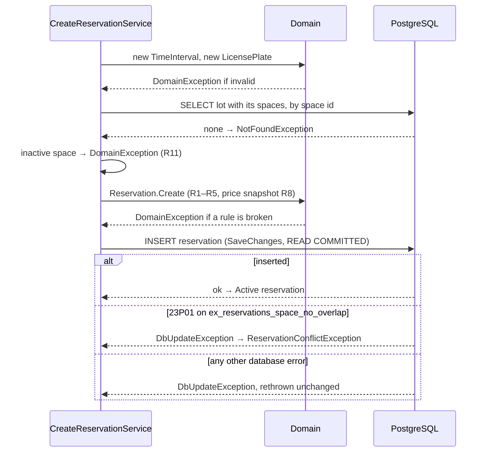

# ADR-002: Overlap prevention with a PostgreSQL exclusion constraint

- **Status:** Accepted
- **Date:** 2026-11-15

## Context

The central requirement of CityPark is that a parking space is never reserved twice for
overlapping times, even when two requests arrive at the same moment (R6). The same holds for a
vehicle: one plate cannot have two overlapping reservations in any lot (R7). Intervals are
half-open, `[start, end)`, so 10:00–11:00 and 11:00–12:00 do not overlap. Only Active
reservations count; a cancelled reservation frees the space and the plate (R9).

A check in application code ("is there an overlapping reservation?") followed by an insert is a
**race condition**: two requests can both run the check before either inserts, both see a free
space and both insert. The guarantee must hold under concurrency, not only in a single-user test.

## Decision

The database enforces both rules with PostgreSQL **exclusion constraints** on the reservation
table:

```sql
CREATE EXTENSION IF NOT EXISTS btree_gist;

ALTER TABLE reservations
  ADD CONSTRAINT ex_reservations_space_no_overlap
  EXCLUDE USING gist (
    space_id WITH =,
    tstzrange(start_time, end_time, '[)') WITH &&
  ) WHERE (status = 1);  -- 1 = Active

ALTER TABLE reservations
  ADD CONSTRAINT ex_reservations_plate_no_overlap
  EXCLUDE USING gist (
    plate WITH =,
    tstzrange(start_time, end_time, '[)') WITH &&
  ) WHERE (status = 1);
```

- `tstzrange(..., '[)')` builds the half-open interval; `&&` means "overlaps".
- `btree_gist` lets a GiST index compare plain values (`space_id`, `plate`) with `=`.
- The `WHERE` clause makes the constraint partial, so cancelled reservations are ignored.

The constraints are created in an EF Core migration with raw SQL, because EF Core cannot model
exclusion constraints.

Space assignment: the application selects free candidate spaces for the interval and inserts the
reservation for the first one. If the insert fails with SQLSTATE `23P01`
(`exclusion_violation`) on the space constraint, another request took that space in the
meantime, and the next candidate is tried. When no candidate is left, or the plate constraint is
violated, the API returns `409 Conflict`.

## Alternatives

### Check in application code, then insert

**Rejected because** of the race condition described above. It works in every manual test and
fails under real concurrent load.

### Pessimistic locking (`SELECT ... FOR UPDATE` on the space, or advisory locks)

Lock the space row before checking and inserting. **Rejected because** every code path that
writes reservations must remember to take the lock in the same order; one missed lock breaks the
guarantee silently. It also does not cover R7, which spans spaces and lots.

### `SERIALIZABLE` transaction isolation

**Rejected because** it detects the conflict only as a generic serialization failure that needs
retries for every reservation write, and the guarantee depends on every writer using that
isolation level.

### One row per 15-minute slot with a unique index

Store a reservation as rows `(space_id, slot_start)` and rely on a unique index. **Rejected
because** a two-hour reservation becomes eight rows, cancellation and extension touch many rows,
and the interval is no longer one value. It would work on any database, which is its main merit.

## Consequences

### Positive

- The rule holds for every writer: the API, a future background job, a manual SQL statement.
- No locks are held while the application chooses a space; the database resolves the race.
- The rule is stated once, declaratively, next to the data it protects.

### Negative and trade-offs

- **PostgreSQL only.** The application cannot switch to SQL Server or SQLite without replacing
  this mechanism. The EF Core in-memory provider and SQLite cannot be used in tests that touch
  reservations; those tests run against real PostgreSQL (for example with Testcontainers).
- The constraint lives in a raw SQL migration, invisible in the EF Core model. A comment in the
  model configuration points to the migration.
- The application must translate `23P01` into a domain conflict and retry the next candidate
  space. This mapping needs its own concurrency tests.
- The GiST indexes add write cost to every reservation insert and update; at the expected volume
  this is negligible.
- The constraint covers overlap only. R10 (at most 10 active reservations per user) is still
  checked in application code and can be exceeded by one under simultaneous requests.

## Validation

Validated in CP-007 (2026-11-16) against PostgreSQL 17 with EF Core 10.0.4 and Npgsql 10.0.3.
The work was done in the project itself instead of a throwaway prototype, and the tests stay as
regression tests for the constraint.

**Schema.** During validation the `InitialCreate` migration created the space constraint; since
CP-012 it lives in its own migration (see [Migration](#migration)). `btree_gist` is declared
in the model with `modelBuilder.HasPostgresExtension("btree_gist")`, so EF Core generates
`CREATE EXTENSION IF NOT EXISTS btree_gist;` before the tables. The constraint is raw SQL:

```sql
ALTER TABLE reservations
  ADD CONSTRAINT ex_reservations_space_no_overlap
  EXCLUDE USING gist (
    space_id WITH =,
    tstzrange(start_time, end_time, '[)') WITH &&
  ) WHERE (status = 1);
```

`start_time` and `end_time` map to `timestamp with time zone`, which `tstzrange` requires. The
plate constraint (R7) is not created yet; it follows in a later card.

**Exception chain.** A rejected insert surfaces in .NET as:

```text
DbUpdateException
  └─ InnerException: Npgsql.PostgresException
       SqlState       = "23P01"   (PostgresErrorCodes.ExclusionViolation)
       ConstraintName = "ex_reservations_space_no_overlap"
```

The application identifies the conflict by `SqlState` and `ConstraintName`, never by the message
text. `ConstraintName` is what will tell the space constraint apart from the plate constraint.
Npgsql hides the `DETAIL` part (the conflicting key values) unless the connection string sets
`Include Error Detail=true`, because those values may contain personal data such as a plate.

**Results.** The tests are in
`tests/CityPark.Infrastructure.Tests/Persistence/ReservationOverlapConstraintTests.cs`:

| Scenario (same day, UTC) | Result |
| --- | --- |
| Space A Active `[10:00,12:00)`, then space A Active `[11:00,13:00)` | second insert fails, `23P01` |
| Space A Active `[10:00,11:00)`, then space A Active `[11:00,12:00)` | both succeed |
| Space A Active `[10:00,12:00)`, then space A **Cancelled** `[11:00,13:00)` | both succeed |
| Space A Active `[10:00,12:00)`, then space **B** Active `[10:00,12:00)` | both succeed |

**Lessons for later work.**

- Tests that rely on the constraint must build the schema with `Database.Migrate()`.
  `EnsureCreated()` builds the schema from the model only and silently skips the raw SQL
  constraint.
- Each insert uses its own `DbContext`. After a failed `SaveChanges` the entity stays tracked,
  and a later `SaveChanges` on the same context would send it again. The retry with the next
  candidate space has to account for this.
- The integration tests start a disposable `postgres:17` container with Testcontainers, so they
  need a running Docker engine. With Docker Engine inside WSL and `dotnet` on Windows, the daemon
  must also listen on `tcp://127.0.0.1:2375`, and `DOCKER_HOST=tcp://localhost:2375` must be set
  on Windows. CI (`ubuntu-latest`) needs no extra setup.

## Migration

Added in CP-012 (2026-11-19). The space constraint has its own migration,
`AddReservationOverlapConstraint`, instead of being part of `InitialCreate`:

- **Up** runs `CREATE EXTENSION IF NOT EXISTS btree_gist;` and the `ALTER TABLE ... ADD
  CONSTRAINT` above as raw SQL (`migrationBuilder.Sql`). `InitialCreate` already creates the
  extension from the model; `IF NOT EXISTS` keeps the migration correct on its own.
- **Down** drops only the constraint. The extension stays, because the model declares it and
  `InitialCreate` owns it.
- The model snapshot does not change, because EF Core does not know about exclusion
  constraints. The migration was created empty with `dotnet ef migrations add` and filled by hand.

**Why a separate migration.** Rolling back removes only the rule, not the whole schema, and the
constraint can be added to a table that already holds reservations. `InitialCreate` was edited
after it was merged, which is acceptable only because no shared or deployed database had applied
it. A local database created before CP-012 has the constraint already, and the new migration
fails there with `42P07` (`relation "ex_reservations_space_no_overlap" already exists`; the
constraint is backed by a GiST index of the same name). Such a database is recreated with
`docker compose down -v`. Once a database outside development exists, applied migrations are
never edited again.

**Existing data.** PostgreSQL checks every existing row when the constraint is added. Active
reservations that already overlap make the migration fail, and because the migration runs in a
transaction, nothing is changed. They must be cleaned up first. Cancelled rows are ignored
because of `WHERE (status = 1)`.

**Tests.** `tests/CityPark.Infrastructure.Tests/Persistence/ReservationOverlapConstraintMigrationTests.cs`
checks that the constraint is in `pg_constraint` with `contype = 'x'`, that migrating back to
`InitialCreate` removes only the constraint, and that the migration applies to a table with
touching Active and overlapping Cancelled reservations. Each test that moves the schema uses its
own database in the shared Testcontainers server.

## Create reservation

Added in CP-016 (2026-11-19). `CreateReservationService.CreateAsync(userId, spaceId, start, end,
plate)` in `CityPark.Application/Reservations` reserves one given space. Choosing a free space
for a lot and trying the next candidate after a conflict, as described in [Decision](#decision),
builds on it and is not part of CP-016.



1. **Validation first.** The interval, the plate and the domain rules are checked before
   anything is written, so a broken rule throws `DomainException` and leaves no row behind.
2. **Unknown space.** A space id that no lot contains throws `NotFoundException`.
3. **No availability check before the insert.** Two parallel requests could both pass it. The
   insert itself is the check: under the default READ COMMITTED isolation a second overlapping
   insert waits for the first transaction, then fails with `23P01`.
4. **Conflict mapping.** `catch (DbUpdateException ex) when (databaseErrors.IsSpaceOverlapViolation(ex))`
   turns only that error into `ReservationConflictException`, a `DomainConflictException` that the
   API will map to `409 Conflict`. The exception filter means every other error is never caught,
   so it keeps its original type and stack trace.
5. **No Npgsql in Application.** `IDatabaseErrors` is declared in Application and implemented by
   `PostgresDatabaseErrors` in Infrastructure, which checks `SqlState` and `ConstraintName`. The
   name matters: the plate constraint (R7) will raise `23P01` too.

**Tests.** `tests/CityPark.Infrastructure.Tests/Reservations/CreateReservationServiceTests.cs`
runs against PostgreSQL 17: a valid request, an overlapping and a touching interval on the same
space, the same interval on another space, two simultaneous overlapping requests (exactly one
succeeds), broken domain rules, an inactive space, a foreign key error that stays a
`DbUpdateException`, and an unknown space.
`tests/CityPark.Infrastructure.Tests/Persistence/PostgresDatabaseErrorsTests.cs` covers the error
classification on its own.

## Concurrency tests

Added in CP-017 (2026-11-19). Twenty parallel requests per round showed that step 3 of
[Create reservation](#create-reservation) is incomplete: two overlapping inserts can also end in
`40P01` (`deadlock_detected`) while PostgreSQL checks the exclusion constraint, because each
transaction waits for the other's uncommitted row. PostgreSQL aborts one of them.

**Decision.** `AppDbContextOptions` enables `EnableRetryOnFailure()`, so EF Core retries transient
errors, `40P01` included. The retried insert either succeeds or fails with `23P01` and becomes a
`ReservationConflictException` as before. A deadlock is not mapped to a conflict directly: the
aborted request may not overlap any reservation that is finally committed, so it would be
rejected for a free interval.

**Consequence.** A user-initiated transaction (`BeginTransaction`) must run inside
`Database.CreateExecutionStrategy().ExecuteAsync(...)`, otherwise EF Core throws, because it
cannot retry a transaction it did not start.

The scenarios are described in [docs/testing.md](../testing.md#concurrency-tests).

## Create reservation by lot

Added in CP-030 (2026-11-23). `CreateReservationService.CreateInLotAsync(userId, lotId, start,
end, plate)` implements the space assignment from [Decision](#decision):

1. The booking rules are checked first, as in `CreateAsync`.
2. One query returns the active spaces of the lot that no Active reservation overlaps, ordered by
   label, at most `MaxAttempts` (10). It is a hint only; a parallel request can take any of them.
3. Each candidate gets its own `SaveChanges`. On `23P01` the failed reservation is detached, as
   the lesson under [Validation](#validation) requires, and the next candidate is tried. No
   explicit transaction surrounds the loop: after a failed statement PostgreSQL rejects every
   later one in the same transaction (`25P02`).
4. With no candidate left it throws `NoFreeSpaceException`, a `DomainConflictException` (409).

`CreateAsync` with an explicit space is unchanged and never falls back to another space.
