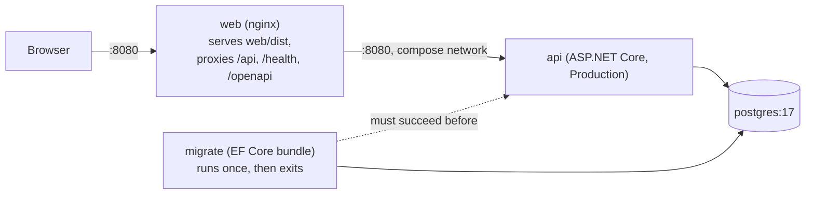
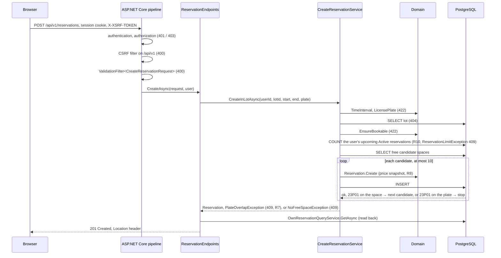

# Architecture

CityPark is a layered monolith with four projects
([ADR-001](adr/0001-monolith-with-four-projects.md)). Dependencies point inwards only:

```text
CityPark.Api            → CityPark.Application, CityPark.Infrastructure
CityPark.Infrastructure → CityPark.Application, CityPark.Domain
CityPark.Application    → CityPark.Domain
CityPark.Domain         → nothing
```

## Runtime view

The local stack (`docker compose --profile app`, see the [README](../README.md#run-the-whole-stack))
runs four containers. The browser reaches only nginx:



- **One origin.** The web app and the API share `localhost:8080`, so the session cookie is
  same-origin, `SameSite=Strict` works and CORS stays off ([auth.md](auth.md#cors)). In
  development the Vite dev server plays the role of nginx.
- **Migrations are a separate step.** The API never migrates on start-up. The `migrate` job
  applies the pending migrations, and the API starts only after it has succeeded, so two API
  instances can never race on the schema.
- **The API has no published port.** It is reached only through nginx. The database port is
  published on loopback only (`127.0.0.1`), for local tools.

## What lives where

| Concern | Project | Main types |
| --- | --- | --- |
| Entities and booking rules R1–R5, R8, R9, R13, R14 | Domain | `Reservation`, `TimeInterval`, `LicensePlate`, `ParkingLot`, `ParkingSpace`, `Rate`, `OpeningHours` |
| Business errors | Domain | `DomainException` (422), `DomainConflictException` (409) |
| Use cases, ownership, R11, R12 | Application | `CreateReservationService`, `CancelReservationService`, `AvailabilityService`, `QuoteService`, `OwnReservationQueryService`, `AdminLotService`, `AdminReservationQueryService` |
| Persistence ports | Application | `IAppDbContext`, `IDatabaseErrors` |
| City time zone and clock | Application | `TimeZoneInfo` for Europe/Sarajevo and `TimeProvider`, both singletons ([ADR-004](adr/0004-utc-storage-and-sarajevo-business-day.md)) |
| EF Core model, migrations, R6 constraint | Infrastructure | `AppDbContext`, `Configurations/*`, `Migrations/*` |
| PostgreSQL error mapping | Infrastructure | `PostgresDatabaseErrors` (`23P01`, `23505` by constraint name) |
| Identity, admin and demo seeding | Infrastructure | `AdminSeeder`, `DevelopmentDataSeeder` |
| HTTP endpoints, request and response DTOs | Api | `*Endpoints`, `*Request`, `*Response` per feature folder |
| Authentication, CSRF, rate limiting | Api | `AuthSetup`, `CsrfProtection`, `AuthRateLimiting` ([auth.md](auth.md)) |
| Request shape validation (400) | Api | `ValidationFilter<T>`, `.WithValidation<T>()` |
| Exception to ProblemDetails | Api | `ApiExceptionHandler` ([api-conventions.md](api-conventions.md#error-contract)) |
| OpenAPI document and examples | Api | `MapOpenApi()`, `OpenApiExamples` |

There is no repository layer, mediator or mapper library: a use case is a plain class that
gets `IAppDbContext` and uses LINQ directly ([ADR-001](adr/0001-monolith-with-four-projects.md)).
`AppDbContext` is registered under both types with one scoped instance, so a request has one
unit of work.

## A request through the layers

`POST /api/v1/reservations` with a `lotId`, from the browser to the database and back:



1. **Pipeline.** `UseExceptionHandler` is first, so every later exception becomes ProblemDetails.
   Authentication reads the cookie; authorization rejects a missing session (401) or role (403)
   **before** the body is read.
2. **Filters.** The `/api/v1` group checks the antiforgery token, then the endpoint's
   `ValidationFilter` checks the request DTO: required fields, and exactly one of `spaceId` and
   `lotId`. Shape errors are 400 and never reach the use case.
3. **Endpoint.** Takes the user id from the cookie, never from the body, and calls the use case.
   It holds no business logic.
4. **Use case.** Builds the value objects, loads the lot and checks the booking rules in the
   domain before it looks for a space, so a broken rule is 422 even when the lot is full. Then it
   checks the R10 limit with a count and inserts. A plate conflict ends the loop at once, because
   every other space would fail for the same car.
5. **Database.** The exclusion constraints decide which parallel insert wins
   ([README](../README.md#how-double-booking-is-prevented),
   [ADR-002](adr/0002-overlap-prevention-with-exclusion-constraint.md)).
6. **Errors.** Nothing in the endpoint or the use case catches an exception to build a response.
   `NotFoundException`, `DomainException` and `DomainConflictException` travel up to
   `ApiExceptionHandler`, which maps them to 404, 422 and 409 in one place.
7. **Response.** The endpoint reads the reservation back through the same query as `GET`, so
   the 201 body is exactly what the `Location` URL returns.

## Time

- Instants are stored as `timestamptz` in UTC. The API accepts ISO 8601 instants with an offset
  and converts them to UTC at the boundary of the use case.
- Grid, opening hours and the single-day rule are checked in Europe/Sarajevo local time by the
  domain, with the `TimeZoneInfo` from DI. Opening hours are local wall-clock `time` columns.
- The clock is `TimeProvider`, so tests move time with `FakeTimeProvider` instead of waiting.

See [ADR-004](adr/0004-utc-storage-and-sarajevo-business-day.md).

## Frontend

`web/` is a single-page app, organised by feature:

| Folder | Content |
| --- | --- |
| `src/api` | `client.ts` (typed `openapi-fetch` client), `http.ts` (CSRF token before every write), `schema.d.ts` (generated from `openapi/v1.json`) |
| `src/features/lots` | Lot list, interval picker, space plan with availability, price summary |
| `src/features/reservations` | Booking panel, confirmation, "My reservations", cancel dialog |
| `src/features/auth` | Log in, register, `RequireAuth`, `RequireRole` |
| `src/features/admin` | Lots, spaces and reservations for the Admin role |
| `src/features/home` | Landing page |
| `src/components` | Site layout, navigation, shared widgets |

Server state lives in TanStack Query; there is no global store. The frontend checks roles only
to hide pages. Every rule and permission is enforced again by the API.

## Layer rules

| Rule | Enforced by |
| --- | --- |
| Domain depends on no other layer | Compiler and architecture tests |
| Application does not depend on Infrastructure or Api | Compiler and architecture tests |
| Domain does not use EF Core (any package), Npgsql or ASP.NET Core | Architecture tests |
| Application does not use an EF Core provider (Npgsql) or ASP.NET Core | Architecture tests |

Application may use core EF Core (`Microsoft.EntityFrameworkCore`) for `DbSet<T>` and LINQ in
`IAppDbContext`. This trade-off is recorded in ADR-001.

### Why the compiler alone is not enough

The project references already form a one-way graph. A reference from Domain or Application to
an outer layer creates a cycle, and the restore fails with `MSB4006: There is a circular
dependency`. NuGet packages do not create cycles, so a project can add `Npgsql` or ASP.NET Core
without any build error. The architecture tests catch that case.

## Architecture tests

`tests/CityPark.Architecture.Tests` uses [NetArchTest](https://github.com/BenMorris/NetArchTest)
and runs with `dotnet test`, so CI runs it as well. The tests check two things:

- **Namespaces of the types each layer uses** (NetArchTest). For example, no type in Domain may
  use a type from `Microsoft.EntityFrameworkCore`.
- **Assemblies each layer references.** Provider extension methods such as `UseNpgsql` are
  declared in the `Microsoft.EntityFrameworkCore` namespace, so the namespace rule does not see
  them. The compiled assembly still references `Npgsql.EntityFrameworkCore.PostgreSQL`.

Both checks look at the compiled assembly. A package that is added but never used leaves no
trace in it, so it is not reported. Code review covers that case.

### Checking that the tests work

During CP-038 the rules were broken on purpose and then the change was reverted:

| Change | Result |
| --- | --- |
| `ProjectReference` from Domain to Infrastructure | Restore fails with `MSB4006` (circular dependency) |
| `Microsoft.EntityFrameworkCore` package in Domain and a property of type `DbContext` | `Domain_DoesNotDependOnEfCoreOrAspNetCore` fails and names the type |

Run only the architecture tests:

```bash
dotnet test --project tests/CityPark.Architecture.Tests/CityPark.Architecture.Tests.csproj
```
