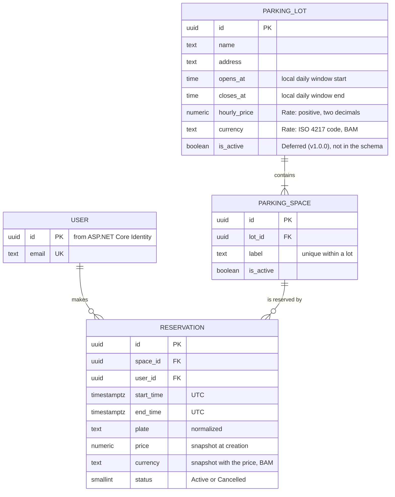

# CityPark – Product Brief

## 1. Product overview

CityPark is a web application for reserving parking in a fictional city. A driver chooses a parking lot and a time interval, and the system reserves a concrete parking space for that interval. The city has one operator who runs all lots; an administrator maintains them.

The product is intentionally small and focused. Its central engineering requirement is that **a parking space can never be reserved twice for overlapping times**, even when two requests arrive at the same moment.

## 2. Objectives

- Let a driver check availability and reserve parking in a few steps.
- Guarantee data integrity of reservations (no double booking) at the database level.
- Keep business rules explicit, testable and documented with examples.
- Stay small enough to be understood, tested and defended end to end.

## 3. Actors

| Actor | Description |
|---|---|
| **Visitor** | Not signed in. Can browse lots and check availability |
| **Customer** | Registered driver. Creates, views and cancels own reservations |
| **Administrator** | Operator staff. Manages lots and spaces; views and cancels any reservation |

An administrator account is created from configuration at first start; there is no public admin registration.

### Permission matrix

| Capability | Visitor | Customer | Admin |
|---|---|---|---|
| Browse lots, prices, opening hours | yes | yes | yes |
| Check availability | yes | yes | yes |
| Register, sign in | yes | – | – |
| Create a reservation | no | yes | yes |
| View own reservations | no | yes | yes |
| Cancel own reservation (until it starts) | no | yes | yes |
| View and cancel any reservation | no | no | yes |
| Create and edit lots, spaces, price, opening hours | no | no | yes |
| Deactivate a space | no | no | yes |
| Deactivate a lot — **Deferred (v1.0.0)**; workaround: deactivate the lot's spaces | no | no | – |

## 4. User journeys

### Customer

1. Opens the application and sees the list of lots with price per hour and opening hours.
2. Selects a lot, a date and a start and end time (15-minute steps).
3. Sees whether space is available and the price, shown as **billed hours** (for example "75 min, billed 2 h, 4.00 BAM").
4. Signs in or registers if not already signed in. The selection is kept.
5. Enters the license plate and confirms.
6. Receives a confirmation with the assigned space label, interval, plate and price.
7. Later opens "My reservations" and may cancel any reservation that has not started yet.

If another driver takes the last free space at the same moment, the customer gets a clear "no longer available" message and can pick another time.

### Administrator

1. Signs in with an administrator account.
2. Creates or edits a lot (name, address, opening hours, hourly price) and its spaces.
3. Views reservations (all lots) and cancels one when needed.
4. To take a space out of service, first cancels its future reservations (the system lists them), then deactivates it. Deactivating a whole lot is **Deferred (v1.0.0)**; until then the administrator deactivates each of the lot's spaces, under the same check.

## 5. Functional scope

### MVP (must have)
- Registration, sign in, sign out, current user (cookie session).
- Lots with opening hours, hourly price and spaces.
- Availability for a lot and an interval (number of free spaces).
- Create a reservation: the system assigns a free space.
- List and view own reservations; cancel own reservation until it starts.
- Admin: manage lots and spaces; list and cancel any reservation.
- Minimal React frontend for the customer journey.
- One-command local setup (Docker Compose).

### Optional (should / could have)
- Extending an existing reservation (first candidate; the data model already supports it).
- Admin user interface.
- Price quote endpoint.
- Weekly opening hours and closures; space categories (accessible, electric charging); peak pricing.
- Written query-plan analysis for the availability query.

### Out of scope
Payments, e-mail or push notifications, check-in and no-show handling, guest reservations, vehicles as a managed entity, overnight and multi-day reservations, foreign and special license plates, maps, multiple operators or cities.

## 6. Business rules

All times are evaluated in the city's time zone (**Europe/Sarajevo**) and stored in UTC. An interval is written `[start, end)`: the start belongs to it, the end does not. A reservation is **Active** or **Cancelled**; "upcoming", "in progress" and "finished" are derived from the current time.

| # | Rule | Exact value | Valid example | Invalid example | Enforced in |
|---|---|---|---|---|---|
| R1 | **Time grid.** Start and end fall on a 15-minute grid, no seconds | :00, :15, :30, :45 | 10:15–11:30 | 10:10–11:30 | Domain |
| R2 | **Minimum duration** | 30 minutes | 10:00–10:30 | 10:00–10:15 | Domain |
| R3 | **Single day, inside opening hours.** A reservation does not cross midnight and lies within the lot's opening hours. The end may equal the closing time. Lot open 07:00–22:00 | `opens_at ≤ start`, `end ≤ closes_at` | 21:00–22:00 | 21:30–22:30; 23:00–01:00 | Domain |
| R4 | **Booking horizon.** The start is at most 30 days after the moment of the request. Now is 15 Nov, 10:00 | start ≤ now + 30 days | start 15 Dec, 10:00 | start 15 Dec, 10:15 | Domain |
| R5 | **Start tolerance.** The start may be at most 5 minutes in the past. Now is 10:04 | start ≥ now − 5 min | start 10:00 | start 09:55 | Domain |
| R6 | **No overlap per space.** Two Active reservations of the same space never overlap. Touching intervals are allowed | `[start, end)` | 10:00–11:00 and 11:00–12:00 | 10:00–11:00 and 10:30–11:30 | **Database** (exclusion constraint) |
| R7 | **No overlap per vehicle.** The same (normalized) plate cannot have two overlapping Active reservations, in any lot | `[start, end)` | plate A: 10–11, then 11–12 | plate A: 10–11 in lot 1 and 10:30–11:30 in lot 2 | **Database** (exclusion constraint) |
| R8 | **Price.** Every started hour is billed as a full hour: `ceil(minutes / 60) × hourly price`. Calculated at creation and stored. Hourly price 2.00 BAM | whole hours | 60 min = 2.00; 61 min = 4.00; 121 min = 6.00 | a stored price that changes when the hourly price changes | Domain; stored in the reservation |
| R9 | **Cancellation.** A customer may cancel until the reservation starts. An administrator may cancel at any time. Cancelling twice is a conflict, also when both requests arrive at the same moment. A customer sees another user's reservation as not found. A cancelled reservation frees the space and the plate | start time | cancel at 09:59 for a 10:00 start | cancel at 10:00 or later (customer); second cancel; another customer's reservation (not found) | Domain; ownership in Application; simultaneous cancels by the database ([ADR-005](adr/0005-optimistic-concurrency-on-xmin-for-cancellation.md)) |
| R10 | **Limit per user.** At most 10 Active future reservations per user | 10 | 10th reservation accepted | 11th rejected | Application (soft rule; parallel requests of one user can all pass the count) |
| R11 | **Active space.** Inactive spaces do not receive new reservations. Inactive lots: **Deferred (v1.0.0)**, a lot has no active flag; workaround: deactivate the lot's spaces | – | active space | deactivated space | Application |
| R12 | **Deactivation.** A space with future Active reservations cannot be deactivated (409); the response lists them. Lot deactivation: **Deferred (v1.0.0)**; workaround: deactivate the lot's spaces, each under this check | – | empty space is deactivated | space with a Friday reservation | Application |
| R13 | **Changes by the administrator.** A new price or new opening hours apply only to new reservations; existing reservations stay valid | – | an old reservation keeps its price | an old reservation is repriced | Domain |
| R14 | **License plate.** Normalized: spaces and hyphens removed, upper case, Cyrillic A, Е, Ј, К, М, О, Т converted to Latin. Then it must match the current Bosnia and Herzegovina format | `^[AEJKMOT][0-9]{2}[AEJKMOT][0-9]{3}$` | `a12-k-345` → `A12K345` | `B12-K-345`; `A1-K-345` | Domain |

### Worked examples
- **Opening hours (R3):** a lot is open 07:00–22:00. Reservation 20:00–22:00 is valid (ends at closing time). Reservation 21:45–22:15 is rejected.
- **Overlap (R6):** space 7 has Active 10:00–11:00. A request that is assigned space 7 for 11:00–12:00 is accepted. A request for 10:30–11:30 cannot use space 7; if no other space is free, the request fails with a conflict.
- **Price (R8):** hourly price 2.00 BAM. 10:00–11:15 is 75 minutes, billed 2 hours, price 4.00 BAM. If the administrator later changes the hourly price to 3.00 BAM, this reservation still costs 4.00 BAM.
- **Cancellation (R9):** a reservation at 10:00–11:00 can be cancelled by the customer at 09:59; at 10:01 it cannot. An administrator can cancel it at 10:30. Another customer who tries to cancel it gets "not found", the same answer as for an id that does not exist, so other users' reservations cannot be discovered. After the cancel, 10:30–11:30 on the same space can be booked.
- **Vehicle (R7):** plate `A12K345` has an Active reservation 10:00–11:00 in lot 1. A reservation for the same plate 10:30–11:30 in lot 2 is rejected. 11:00–12:00 is accepted.
- **Space assignment:** a lot has 2 spaces, and both are free at 10:00–11:00. Three drivers request that interval at the same moment. Two receive different spaces; the third is rejected with a conflict. This is guaranteed by the database, not by counting.
- **Availability (R1–R6):** a lot has 3 active spaces, and space 1 has an Active reservation 10:00–11:00. For 10:30–11:30, 2 spaces are free; for 11:00–12:00, all 3 are free, because touching intervals do not block (the same `[start, end)` rule as R6). A Cancelled reservation blocks nothing. An inactive space is neither listed as free nor counted in the capacity. An interval that breaks R1–R5 is rejected with the same error as a reservation request, and an unknown lot is "not found".

## 7. Domain glossary

| Term | Meaning in CityPark | Not to be confused with |
|---|---|---|
| **City** | The fictional city; one operator, one time zone. A configuration, not a table | – |
| **Parking lot** | A parking area with name, address, opening hours, hourly price and spaces | Parking space |
| **Parking space** | One physical place in a lot, identified by a label unique within the lot | Capacity |
| **Capacity** | Number of active spaces in a lot; derived, never stored | Availability |
| **Hourly price** | Price of one billed hour, set per lot, in BAM | Reservation price |
| **Opening hours** | The daily time window (`opens_at`–`closes_at`) in which a lot accepts reservations. Same every day | The reservation interval |
| **Reservation** | A claim on one space for one interval by one customer and one vehicle, with a stored price | – |
| **Reservation status** | Active or Cancelled. Other states are derived from time | – |
| **Reservation state** | What the customer sees: Upcoming, InProgress, Finished or Cancelled. Derived from the status and the current time, never stored ([API contract](api.md#own-reservations)) | Reservation status |
| **Availability** | Number of active spaces without an overlapping Active reservation for a given interval | Capacity |
| **Time grid** | The 15-minute steps at which reservations start and end | Billing unit |
| **Billed hour** | A started hour, billed in full | Actual duration |
| **Booking horizon** | How far ahead a reservation may start: 30 days | Opening hours |
| **Start tolerance** | A reservation may be created with a start up to 5 minutes in the past | A late-arrival grace period (not supported, there is no check-in) |
| **Single-day rule** | A reservation lies within one local day and the opening hours | Booking only for the current day (not required) |
| **Half-open interval** | `[start, end)`: the start is included, the end is not. This is why 10–11 and 11–12 do not overlap | – |
| **Conflict** | An attempt to reserve a space or a vehicle that is already reserved for an overlapping interval | – |

## 8. Data model

| Relationship | Cardinality | Mandatory | On removal |
|---|---|---|---|
| Parking lot → parking space | one to many (at least one) | a space always has a lot | lots are never deleted; lot deactivation is Deferred (v1.0.0) |
| Parking space → reservation | one to many (may be zero) | a reservation always has a space | spaces are deactivated, never deleted (R12) |
| User → reservation | one to many (may be zero) | a reservation always has a user | reservations stay as history |

Design notes
- **Why no Rate or OpeningHours table:** there is exactly one hourly price and one daily window per lot, and a reservation stores its own price, so no history is needed. In the domain they are value objects (`Rate`, `OpeningHours`); in the database they are columns of the lot.
- **Why no capacity or free-spaces column:** both are derived from spaces and reservations. Storing them would duplicate data that can disagree.
- **Why a Space table:** the database can only prevent double booking if the thing being booked exists as a row.
- **User** is the ASP.NET Core Identity user. CityPark does not duplicate its tables.

## 9. Domain invariants

| # | Invariant | Enforced by |
|---|---|---|
| I1 | A space belongs to exactly one lot; the space label is unique within the lot | Foreign key, unique constraint |
| I2 | A reservation references an existing space and user | Foreign keys |
| I3 | A reservation has `end > start`, lies on the 15-minute grid and satisfies the minimum duration | Domain validation |
| I4 | Active reservations of the same space never overlap (half-open) | Database exclusion constraint on `(space_id, [start_time, end_time))` where status is Active |
| I5 | Active reservations of the same plate never overlap | Database exclusion constraint on `(plate, [start_time, end_time))` where status is Active |
| I6 | The stored price does not change after creation | Domain: price is set once at creation |
| I7 | An inactive space receives no new reservation (for a lot: Deferred (v1.0.0), deactivate its spaces) | Application validation |
| I8 | A space with future Active reservations cannot be deactivated (for a lot: Deferred (v1.0.0), deactivate its spaces) | Application validation |
| I9 | A reservation moves only from Active to Cancelled; cancelling twice is a conflict | Domain; simultaneous updates by an `xmin` concurrency token (ADR-005) |
| I10 | A user has at most 10 Active future reservations | Application (soft rule, see R10) |

The two database guarantees (I4, I5) need the PostgreSQL `btree_gist` extension and are covered by the concurrency tests ([testing.md](testing.md#concurrency-tests)).

## 10. Assumptions and limitations

- One operator, one city, one time zone (Europe/Sarajevo). Currency is BAM.
- Reservations are short-term: they do not cross midnight. Overnight and multi-day parking are not supported.
- One daily opening window per lot. Weekly schedules, holidays and temporary closures are not supported. Lot deactivation is **Deferred (v1.0.0)**; a lot is taken out of service by deactivating its spaces.
- Space assignment takes the first free space. This can fragment capacity (a request may be rejected although a different earlier assignment would have fitted it). An optimizing assignment is out of scope.
- No payments: the price is calculated and stored, not charged.
- No check-in or no-show handling: a reservation holds the space for its whole interval.
- Only current Bosnia and Herzegovina license plates are accepted; foreign and special plates are not.
- The limit of 10 active future reservations per user is a soft rule: parallel requests of one user can all pass the count, so the limit can be exceeded.
- There is no notification system.

## 11. Open questions

- Name of the fictional city (not required for the implementation).
- The set of letters allowed on Bosnia and Herzegovina plates was taken from a public encyclopedia and should be verified against an official source.
